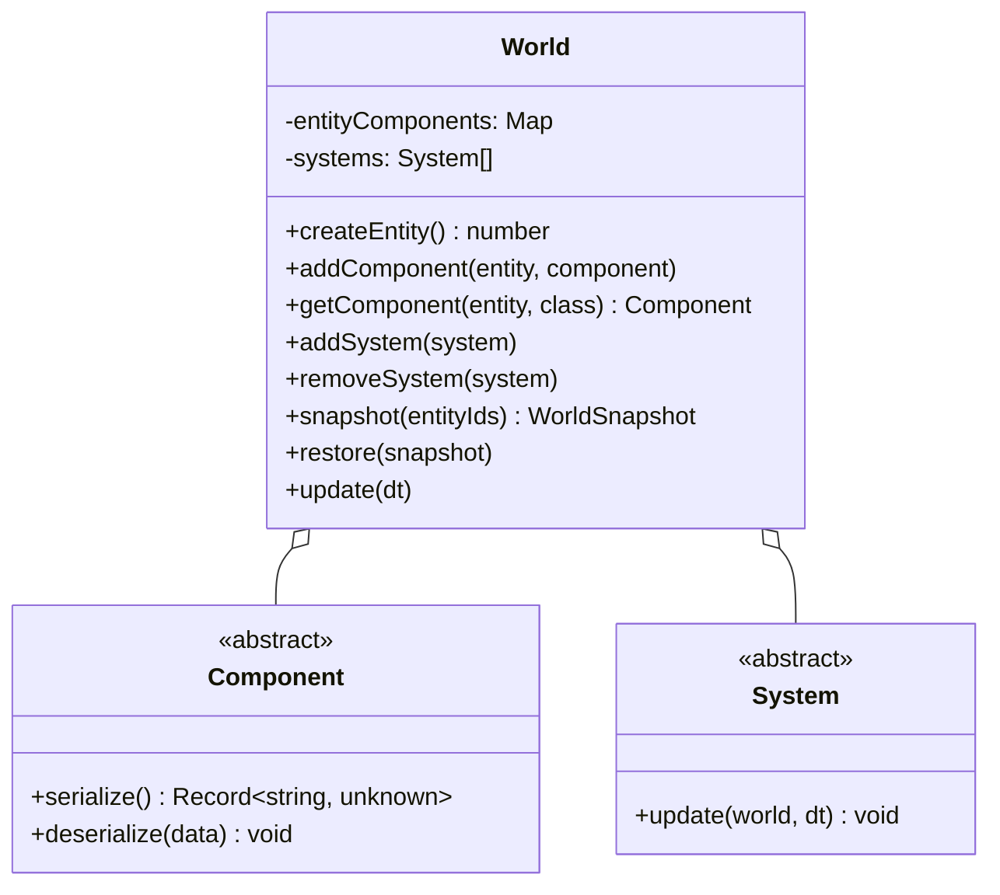

# Entity Component System (ECS) Architecture

## 1. Core Architecture

The game uses a lightweight, type-safe ECS located in `src/ecs/`.

---

## 2. Components

All entity data is stored in discrete component instances inheriting from `Component` (`src/ecs/Component.ts`):

| Component | Responsibility | Replicated? |
| --- | --- | --- |
| `IdentityComponent` | Faction (`blue` / `red`), squad index, character name | Yes |
| `PositionComponent` | Grid coordinate `(x, y)`, logical world position, target yaw (the view's facing), and `heading` — one of eight directions, the facing the rules read (from behind) | Yes |
| `HealthComponent` | Current and maximum HP. The maximum is `derive(sheet).maxHp` — read off the character's Health attribute, not stated by the sheet — with traits moving it from there | Yes |
| `CharacterComponent` | The sheet the unit was rolled or kept as, the role it trained for and the fatigue it deployed with. Not changed during a match (the sheet is replaced only when a peer's real one arrives, before the first turn), but state like the rest: it digests and rewinds with the unit, and the trait refold reads it | Yes |
| `ArmorComponent` | Current and maximum armour. Worn plate raises the maximum; shred takes the current down for the rest of the match, and a repair kit is the one thing that puts it back, capped at the maximum | Yes |
| `ActionPointsComponent` | Points left and the ceiling (`derive(sheet).maxAp`, from Agility, then traits, then the share of gear's AP bite Strength carries for free), plus `spentThisTurn` and `exhaustedTurns` — what a unit *used*, which is what exhaustion is judged on | Yes |
| `StanceComponent` | Crouched (and a crouched unit moves crouched, at `RULES.crouchStepCost` a step), moving, the route being walked, corner peek, and `firedThisTurn` — a muzzle flash gives a position away until the unit's own next turn | Yes |
| `WeaponComponent` | Equipped weapon id; the instance it clones carries the serial and the fitted rail. Only the id replicates — a peer's fitted kit shows up in the numbers they resolve, never in this side's copy | Yes (id only) |
| `AmmoComponent` | Loaded round id; clip state lives on the weapon instance | Yes |
| `InventoryComponent` | Grenades carried, by kind | Yes |
| `ItemsComponent` | Items carried, by id, including body-worn kit. Counts drop as items are spent, which is also how a peer sees a use happen. An item its carrier cannot operate still sits here — the Intelligence gate refuses the *use*, it does not empty the pouch. Weapon attachments are *not* here — a rail belongs to the weapon | Yes |
| `SightedComponent` | What the other side perceives: `seen` (fog writes it, a view mirrors it onto a mesh) and `known` (whether its *sheet* has been worked out) | Local (per-peer knowledge) |
| `AwarenessComponent` | What the unit knows is going on: unaware, alerted (heard something, turned toward it) or engaged (in the fight), plus the turns it has spent alerted without hearing anything new. Decides what a watcher reacts to, so both peers resolve it by the same rules (`core/Awareness`) | Yes |
| `MoraleComponent` | Nerve left (0–100), the break the unit is in — panic, frenzy or freeze — and the turns it has begun broken. Moved by stress from resolved attacks and rolled at each handover from the match's dice (`core/Morale`); a broken unit takes no orders | Yes |
| `TraitsComponent` | What a unit's sheet, wounds, role and gear fold to: the one place every trait-driven number is read from (evasion, crit immunity and chance, accuracy, range falloff, silenced, step cost, damage taken, whether gear drags). `Soldier.refreshTraits` writes it and the fold itself is private to that call, so a rewind that puts this component back puts every trait-driven number back | Yes |
| `StatusesComponent` | Turn-decaying statuses, each with `turnsLeft` and `stacks`; absent stacks mean one, so a peer omitting the count cannot disarm a status | Yes |
| `GrenadeSpecsComponent` | Per-unit ordnance: throw range from Strength, blast radius and armour shred from the thrower's Demolitions training. Stamped into the unit's own specs rather than applied at the throw site, so the planner's preview, the range check and the debug panel all read the numbers *this* arm can reach — and a peer sees the arm it is up against rather than its own stock copy | Yes |
| `CoverRulesComponent`, `AimRulesComponent`, `MatchRulesComponent`, `StatusSpecsComponent` | Rule tables on the global entity, so both peers resolve against the same constants | Yes (global entity) |
| `WallComponent` | Wall segment state for the terrain entities: its `kind`, which for a door is its state too — shut, open or locked (`core/Doors`) | Yes |
| `DeedsComponent` | A unit's service record for the match — rounds landed and crits by weapon class, kills, damage taken, attacks on the unaware, turns spent to the last point, blows, doors forced, tiles in heavy kit, advanced kit used — written by the rules on both peers (`CombatSystem.record`, `CommandSystem`) and turned into growth after the match (`core/Progression`) | Yes |
| `GroundComponent` | What has happened to the ground since the map was made, sparse and sorted by tile: burning tiles and turns left, smoke, tiles burned to ash, crates burned away. One entity for the map, owned by the host | Yes |

Nothing about a character's derived stats replicates in its own right. A sheet carries four
attributes and no ceilings, and each side runs `derive()` over the attributes it holds, so the
numbers above travel only as the *resolved* state of a component the rules already had to
send — never as a ceiling a peer asserted.

Current values for every status and trait are in the generated
[status and trait catalogue](../design/gdd/status-and-trait-catalog.md).

---

## 3. Systems

Systems execute business logic across entities on each tick or action:

- **`CommandSystem`**: The one door through which anything changes the world. Every command —
  the player's clicks, the other player's messages, a replay, the referee, the sweep's policy —
  is a `Command` (`src/rules/Command.ts`, the world-changing subset of `NetworkMessage`) applied by `apply(command,
  origin)`, which looks the units up, calls the system that owns the rule, and reports
  `onApplied` / `onRefused`. It also owns the reaction trigger: `MovementSystem.onStep` →
  `CombatSystem.reactTo` — and the ears: every step, shot, loud blow and grenade is a `Noise`
  (`src/core/Noise.ts`), and `onNoise(noise, heard)` reports each one somebody on the other side
  heard, with who, worked out from state both peers hold. Peer commands go through `enqueue`, and the queue drains only while
  nothing is walking, so a command is never resolved against a unit still between tiles on this
  screen; `whenSettled` queues a check (the peer's digest) behind them. Registered first, so a
  queued command is applied before the tick that walks it. Origin decides four things only:
  `local` is the one origin sent to the peer, item use is re-checked for legality only when
  `local`, a refusal is a finding from anywhere but `local`, and `rules` — what the rules made
  a broken unit do — is the one origin a broken unit takes a command from. At a handover it
  rolls the incoming side's morale (`core/Morale`, `onMorale`) and queues each panicking or
  frenzied unit's run (`rules/Breakdown`), one command at a time ahead of anything else; a
  `local` command is refused while the queue holds anything, so a player's order can never land
  between two of those steps on one screen and after them on the other. `rules` commands are
  neither sent nor recorded: every side, a replay and the referee derive them again.
- **`MovementSystem`**: Steps entities along A* waypoints, deducts AP per tile, updates stance animations.
- **`CombatSystem`**: One door for every attack, whoever intended it. It evaluates cover and LOS, rolls from the match stream, resolves damage, shreds armour and kills. A peer's shot arrives as an *intent* and goes through the same call the acting side makes — there is no second path that applies numbers somebody else resolved.
- **`ItemSystem`**: Command-driven, not ticked. Applies an item's ordered effect list to a target that defaults to the user; charges the turn's price and the pouch to the *user* whoever is being worked on. The only place that knows what an effect does.
- **`TurnSystem`**: Manages round handovers, resets AP pools, decrements status durations.
- **`WallSystem`**: Updates structural integrity and occlusion of destructible barricades.
- **`GroundSystem`**: The one writer of what is on the ground — fire, smoke, ash, crates burned away (`GroundComponent`, one entity for the map) — and of the grid's dense index over it (`Grid.fire`, `Grid.smoke`, surfaces, blocks), which the rules read on every step and sight line. Implements `core/Fire`'s `Ground` port; a change made to the component from outside (a rewind) bumps its revision and `update` rebuilds the index from the generated map plus the component.
- **`RenderSystem`** (`src/render/RenderSystem.ts`): Presentation-layer ECS system. Reads component state (`PositionComponent`, `StanceComponent`, `HealthComponent`) to drive 3D view representations.

---

## 4. State, Digests & Rewind

Every component implements `serialize(): Record<string, unknown>` and `deserialize(data: Record<string, unknown>)`.

State is **not replicated component by component**. Peers exchange intent commands and each
resolves them through the same systems ([ADR-0004](../design/adr/0004-full-knowledge-lockstep.md));
the old dirty-diff broadcast (`syncDirty`, `onComponentChanged`, `applyRemote`) was deleted
with it. What `serialize` still serves:

1. **The state digest**: `digestWorld` (`src/sim/WorldDigest.ts`) fingerprints a world from the same
   serialisations, plus the match dice's position, exchanged at each handover to catch a
   desynchronisation (a die drawn on one side only shows up as a `dice` divergence).
2. **Rewind (`World.snapshot(entityIds)` / `World.restore(snapshot)`)**: Record and put
   back a whole moment rather than one component. `restore` calls `deserialize` on each
   component and then the entity's `World.onRestored` hook, which for a soldier is
   `refreshTraits`: a restore writes components one at a time and the traits are a fold of
   several of them, so they are refolded once all are back. Nothing observes components
   changing, so there is nothing to suppress or re-baseline.
   Takes named entities rather than all of them: spectator playback only rewinds soldiers,
   and snapshotting a map's worth of wall entities at every event would cost a
   great deal to restore terrain that nothing can change. See
   [P2P Networking §4](networking.md) for what uses it.

### Lifecycle

A system is added with `World.addSystem` and taken out with `World.removeSystem`; whoever
adds it removes it. `MatchSession` keeps the list of what it registered, and `Presenter` removes the
`RenderSystem` it added, so `dispose` takes out exactly that and a rebuilt match leaves the world with the systems a fresh
one has. Per-frame ticking belongs to the caller: `FixedStepLoop` (`src/sim/FixedStepLoop.ts`)
turns engine frames into fixed steps, and `onEachFrame` (`src/engine.ts`) registers it and
returns the function that unregisters it.

### Commands, and why a target on the wire can still matter

Item use is the clearest case of the split between a *command* and *replicated state*, and it
is worth being precise about, because the same message is read two different ways.

- **The command carries a target.** `useItem` gained optional `targetFaction` / `targetIndex`;
  a self-use names nobody, exactly as it did before there was anyone to name.
- **Every side resolves it.** A peer's `useItem` goes through `CommandSystem` like any other
  command and is resolved here, from the same sheets — until ITEM-031 the live receiver applied
  nothing and waited for the user's component updates, while a replay re-ran the use: two
  readings of one message. No component update travels now; the state agrees because both sides resolved the command.
- **The target is load-bearing.** A frame from before targeted use, or one naming a unit this
  side cannot resolve, resolves as a self-use rather than being dropped.
- **No number travels.** Both peers hold both squads' real sheets from the `ready` handshake,
  so a trained medic's amount is derived identically on each side. The wire says *who*, not
  *how much* — and the Intelligence gate is re-checked locally regardless, because how clever a
  character is is a fact about this side's sheet, not a claim a peer gets to make.
