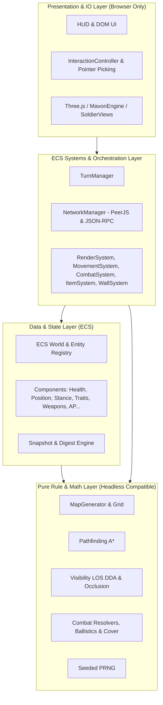

# System Architecture & Runtime Overview

## 1. Architectural Layers

The codebase is strictly layered into decoupled tiers to allow headless execution, deterministic testing, and network synchronization:

---

## 2. Directory Layout & Module Responsibilities

| Directory | Layer | Purpose & Responsibilities | Headless Safe? |
| --- | --- | --- | --- |
| `src/core/` | Core Rules | Pure math, Grid DDA, Line of Sight, Pathfinding, Ballistics, Combat formulas, RNG. | **Yes** (100% pure) |
| `src/rules/` | Game Rules | `Combat`, `Overwatch`, `Movement`, `Breakdown`, `TurnManager`, `Squads`, `MatchEnd`, `StateDigest`, `Rewind` types, the `Command` language, loadout pool rules. | **Yes** (below `ecs`; `tests/layers.test.ts` lists the few edges that still reach up) |
| `src/ecs/` | State & Systems | ECS `World`, component classes, system update loops, snapshot/restore for rewind. | **Yes** (Pure data) |
| `src/wire/` | Wire Contract | `NetworkMessage`, `Rpc`, `JsonRpc`, `Lobby`, `Encounter`, `Transport`, the `Recording` format, `Base64Url`. Shared by the client, `sim` and `src/server`. | **Yes** (imports only `core` and `rules`) |
| `src/sim/` | Simulation | Headless matches: `MatchHost` (the ECS match, driven by intents), `SimMatch` (the sweep's policy), `Replay`, `Balance`, `Recorder`. | **Yes** |
| `src/game/` | Client Orchestration | `NetworkManager`, `ServerConnection`, `InteractionController`, movement/shooting planners, `Battlefield`, `Playback`. | **No** |
| `src/render/`| Presentation | Three.js meshes, animations, tracers, particles, material cloning, ground tiles. | **No** (Requires WebGL) |
| `src/hud/` | Presentation | React (TSX) HUD overlays, menus, loadout screen, portraits, debug panels. | **No** (Requires DOM) |
| `src/camera/`| Presentation | `OrbitRig`, camera inputs, ground raycaster picking. | **No** (Requires Canvas/DOM) |

Imports run downward only — `core` < `rules` < `ecs` < `entities` < `wire` < `sim` < `server` / `game` (the clients, with `render`, `camera`, `hud`) — and `tests/layers.test.ts` fails on a new edge that breaks the order. `wire` sits below `sim` because the simulation is written in the wire's terms (`NetworkMessage`, `Recording`).

---

## 3. Key Invariants & Contracts

1. **Pure Rules are Headless**: `src/core/` and `src/ecs/` must never import from `src/render/`, `src/hud/`, or `src/camera/`.
2. **Deterministic PRNG**: All gameplay calculations (rolls, spreads, hit checks, map seeds) use seeded PRNG from `src/core/rng.ts`. One stream per match — `matchDice(seed)` — injected into the resolvers and drawn only by the rules; presentation takes its own randomness, since a draw from the match stream moves every later roll in it. Enforced by `tests/determinism.test.ts`, which also refuses library maths (`hypot`, `atan2`, `cos`, ...) and clock reads (`Date.now`, `performance.now`, `new Date()`) anywhere the rules or the server can see them except in files it lists with a reason: `sqrt` is correctly rounded by IEEE 754 and the rest are not, and a facing is replicated and digested.
3. **Headless replay**: `src/sim/Replay.ts` (`bun run replay <file>`) refights a recorded intent stream through the real systems with no engine, no canvas and nothing watching. It is how the *receiving* side of the wire is tested without two browsers: every shot in a file arrives as a peer's does, so the divergence check and the state digest are exercised by running a match somebody already played.
4. **Intent on the wire**: a command carries what a player decided — `fireShot` is a shooter, a target and a mode — and both peers resolve it through the same rules from one seeded stream per match. No outcome travels, so no outcome can arrive wrong, and the bug class where an attacker needed facts about its target it only had a stale copy of is gone by construction. A disagreement is a desynchronisation, reported by the state digest exchanged at each handover. See [ADR-0004](../design/adr/0004-full-knowledge-lockstep.md).
