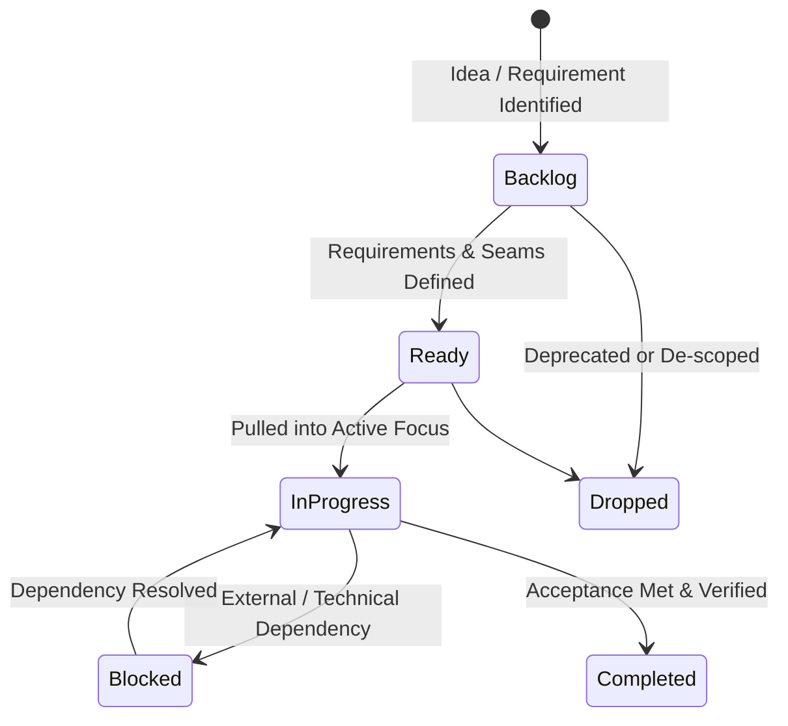

# Engineering & Product Backlog

## Backlog Taxonomy & Kanban Workflow

Items in the backlog follow a pull-based Kanban flow:

### Document Map & Tooling
- **Beads (`bd`)**: Active issues are tracked in the Dolt-backed beads database (`.beads/`). Run `bd list` or `bd ready`.
- [Active Backlog](./active-backlog.md): detailed specifications of open roadmap items cross-referenced with beads IDs.
- [Focus Board](../plans/active-focus.md): what is in flight, pull queue priorities, and caveats left open by finished work.
- [Completed Archive](./completed.md): closed items — what was delivered, measured and left open, and rejected items with their reasoning.

### Item ID Convention
- Architectural & milestone feature items use sequential IDs (`ITEM-001`, `ITEM-002`, ...).
- Granular tasks and issues tracked in beads use the `tictac-<hash>` issue prefix (e.g. `tictac-dwq`, `tictac-0al`).
